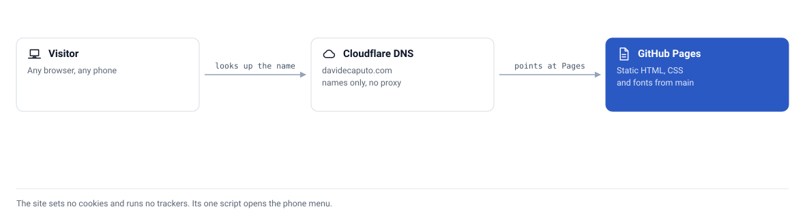

<div align="center">


# 🧑‍💻 Davide Caputo Website

**The personal portfolio of Davide Caputo, senior technical architect, as one static page**


</div>

---

## ✨ Features

| | Feature | What it does |
|---|---|---|
| 🎯 | One page | Focus areas, experience, achievements, GitHub projects, skills and certifications. |
| 🔒 | No contact details | No phone, e-mail address or home town. Visitors reach me through LinkedIn. |
| 📱 | Responsive | One column at 390 px, a menu sheet on phones and tablets. |
| 🚫 | Nothing to track you | No cookies, analytics or third-party requests. Fonts are served from this repository. |
| 🧪 | Rules that stay true | `tests/check_site.py` fails if a phone number, e-mail address or broken link appears. |

---

## 🗺️ Architecture

<picture>
  <source media="(prefers-color-scheme: dark)" srcset="docs/assets/architecture-dark.svg">
  
</picture>

The site is one HTML file, one stylesheet, one small script that opens the phone menu, and two font files.

---

## 🚀 Quick Start

```bash
python3 -m http.server 8000
```

Then open <http://localhost:8000/>. Before a pull request:

```bash
python3 tests/check_site.py
python3 tools/gen_diagram.py --check
```

---

## 📁 Repo structure

```text
Davide-Caputo-Website/
├── index.html          # 🏠 the whole page
├── assets/             # 🎨 site.css, site.js, favicon, self-hosted fonts
├── docs/assets/        # 🖼️ icon and architecture diagram
├── tests/              # 🧪 check_site.py
├── tools/              # 🔧 gen_diagram.py
├── .github/            # 🤖 CI and Dependabot
├── AGENTS.md           # 🤖 agent instructions
├── LICENSE  SECURITY.md  README.md
├── robots.txt  sitemap.xml  .nojekyll
└── .gitignore
```

---

## 🔒 Security

Report a problem through a [private security advisory](https://github.com/CaputoDavide93/Davide-Caputo-Website/security/advisories/new). See [SECURITY.md](SECURITY.md).

---

## 📄 License

Code is [MIT](LICENSE). The text of the CV content is © Davide Caputo.

---

<p align="center"><sub>Made with ❤️ by <a href="https://github.com/CaputoDavide93">Davide Caputo</a></sub></p>
